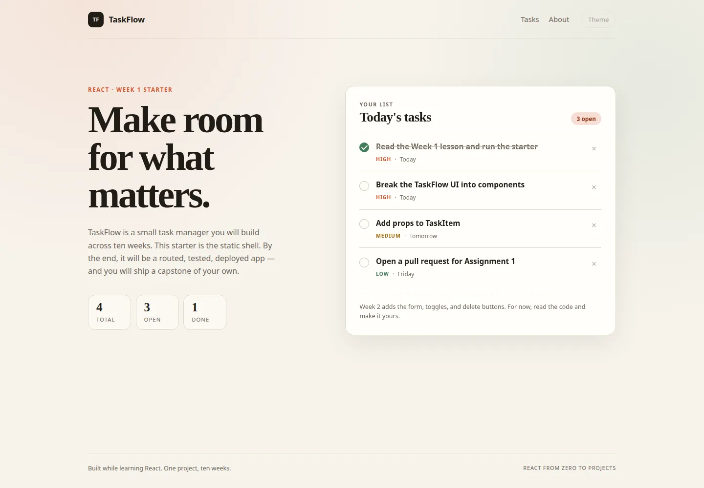

# React From Zero to Projects

A 10-week, project-based React course. You learn React by building **one real
application**, week by week, then ship a **capstone project** of your own.

> **One project. Ten weeks. Real skills.**
>
> This course follows the teaching idea behind
> [kc-clintone/js-starter](https://github.com/kc-clintone/js-starter): instead of
> memorising isolated concepts, every lesson adds one idea to the same app.



---

## The project: TaskFlow

TaskFlow is a task manager. It starts as a static page and grows into a routed,
tested, deployed React application:

- Add, edit, complete, and delete tasks
- Search, filter, and clear completed tasks
- Save tasks in `localStorage`
- Import tasks from a public API
- Multi-page navigation with React Router
- Light/dark theme with Context
- Automated tests and an accessibility pass
- Deployed to the web

Then, in Weeks 9–10, you build **StudySync** — a study planner capstone — on
your own, using everything you practised in TaskFlow.

---

## Who this is for

This course is for someone who knows a little HTML, CSS, and JavaScript
(variables, functions, arrays, objects, and the DOM) and wants to learn React
properly. You do **not** need prior React experience.

If JavaScript still feels shaky, spend a week on the
[JavaScript course](https://github.com/kc-clintone/js-starter) first. React will
be much easier.

**You need:** a computer, Node.js 20.19+ (24 recommended), Git, a GitHub
account, VS Code, and 6–8 hours per week.

---

## What you will learn

| Area | Skills |
| --- | --- |
| Foundations | JSX, components, props, composition, file structure |
| Interactivity | State, events, forms, controlled inputs, immutable updates |
| Side effects | `useEffect`, cleanup, `localStorage`, derived state |
| Architecture | Custom hooks, Context, `useReducer`, provider pattern |
| Data | `fetch`, `async`/`await`, loading and error states, `AbortController` |
| Navigation | React Router, layout routes, URL params, search params |
| Quality | Vitest, Testing Library, accessibility, error boundaries, performance |
| Shipping | Production builds, environment variables, Vercel/Netlify, code review |

---

## Course at a glance

| Week | Focus | What you build | Assignment |
| --- | --- | --- | --- |
| 1 | Components and props | Static TaskFlow UI | [Assignment 1](assignments/week-01/README.md) |
| 2 | State, events, forms | Working in-memory CRUD | [Assignment 2](assignments/week-02/README.md) |
| 3 | Effects and persistence | Search, filters, saved tasks | [Assignment 3](assignments/week-03/README.md) |
| 4 | Hooks, Context, reducer | Refactored architecture + theme | [Assignment 4](assignments/week-04/README.md) |
| 5 | Async and APIs | Import tasks from an API | [Assignment 5](assignments/week-05/README.md) |
| 6 | Routing | Multi-page TaskFlow | [Assignment 6](assignments/week-06/README.md) |
| 7 | Testing and accessibility | Test suite + a11y fixes | [Assignment 7](assignments/week-07/README.md) |
| 8 | Deployment and review | Live TaskFlow + demo | [Assignment 8](assignments/week-08/README.md) |
| 9 | Capstone sprint 1 | StudySync proposal + shell | [Assignment 9](assignments/week-09/README.md) |
| 10 | Capstone sprint 2 | StudySync shipped + demo | [Assignment 10](assignments/week-10/README.md) |

Each week has a lesson in [`docs/`](docs/), an assignment in
[`assignments/`](assignments/), and a pull request to submit.

---

## Repository map

```text
react-starter/
├── src/                     # The TaskFlow starter app (Week 1)
│   ├── components/
│   ├── data/
│   ├── test/
│   ├── App.jsx
│   └── styles.css
├── docs/
│   ├── setup.md             # Install everything, run the app
│   ├── guide.md             # The step-by-step weekly workflow
│   ├── week-01.md … week-10.md
│   ├── instructor-guide.md
│   ├── assessment.md
│   ├── resources.md
│   ├── cheatsheet.md
│   ├── glossary.md
│   └── faq.md
├── assignments/
│   ├── README.md            # Submission rules and grading
│   └── week-01 … week-10/
├── final-project/
│   ├── README.md            # StudySync capstone brief
│   ├── requirements.md
│   ├── proposal.md
│   ├── rubric.md
│   ├── presentation.md
│   ├── api-contract.md
│   ├── mock-api/            # Ready-to-run fake API
│   └── starter/             # Optional StudySync scaffold
├── .github/                 # Issue and pull request templates
├── docs/ci.yml              # GitHub Actions workflow (copy to .github/workflows/)
├── package.json
└── vite.config.js
```

---

## Quick start

```bash
# 1. Clone the repository (replace with your fork's URL if you forked it)
git clone https://github.com/ejao-000/react-starter.git
cd react-starter

# 2. Install dependencies
npm install

# 3. Start the dev server
npm run dev
```

Open the URL printed in the terminal (usually `http://localhost:5173`).

```bash
npm test        # run the test suite once
npm run test:watch
npm run lint    # check code quality
npm run build   # production build
npm run preview # preview the production build
```

Full setup instructions, including Node, VS Code, and Git, are in
[`docs/setup.md`](docs/setup.md).

> **CI:** [`docs/ci.yml`](docs/ci.yml) is a ready-to-use GitHub Actions workflow.
> Copy it to `.github/workflows/ci.yml` to enable it. Pushing workflow files
> requires a GitHub token with the `workflow` scope.

---

## How each week works

1. **Read** the week's lesson in `docs/week-XX.md` (about 45–60 minutes).
2. **Code along** with the guided steps in the starter app.
3. **Complete** the assignment in `assignments/week-XX/README.md`.
4. **Self-check** with the acceptance criteria and the three commands.
5. **Submit** a pull request on a branch named `week-XX/your-name`.
6. **Review** the feedback, make changes, and merge.

The detailed workflow — including exact Git commands and a weekly schedule — is
in [`docs/guide.md`](docs/guide.md).

### Branch and pull request convention

```bash
git switch main
git pull
git switch -c week-03/your-name

# ...work...

git add .
git commit -m "week 03: add search, filters, and persistence"
git push -u origin week-03/your-name
```

Open a pull request titled **`Week 03 — Search, filters, and persistence`** and
use the repository's pull request template. Do not push directly to `main`.

---

## Grading

| Component | Weight |
| --- | --- |
| Weekly assignments (10) | 50% |
| Capstone project | 40% |
| Participation, code review, and demo | 10% |

Every assignment includes a rubric. The capstone has its own 100-point rubric in
[`final-project/rubric.md`](final-project/rubric.md). The full assessment policy
is in [`docs/assessment.md`](docs/assessment.md).

---

## The final project: StudySync

You will design and build a study planner with subjects, study sessions,
dashboard statistics, filtering, persistence, routing, tests, and a deployment.
You may use the provided mock API or save data locally.

- [Capstone brief](final-project/README.md)
- [Requirements](final-project/requirements.md)
- [Proposal template](final-project/proposal.md)
- [Rubric](final-project/rubric.md)
- [Demo script](final-project/presentation.md)
- [Mock API](final-project/mock-api/README.md)

The capstone is intentionally less prescriptive than TaskFlow. You have the
requirements; you make the design decisions. That is the point.

---

## For instructors

[`docs/instructor-guide.md`](docs/instructor-guide.md) contains a 90-minute
session plan, weekly preparation checklists, common learner mistakes, review
guidance, and a 6-week intensive alternative. Suggested answers and checkpoints
are described per week so you can review confidently.

---

## Credits

The course structure and teaching approach are adapted from
[kc-clintone/js-starter](https://github.com/kc-clintone/js-starter) by Kc
Clintone. This React edition was created for training at
[ejao-000/react-starter](https://github.com/ejao-000/react-starter).
