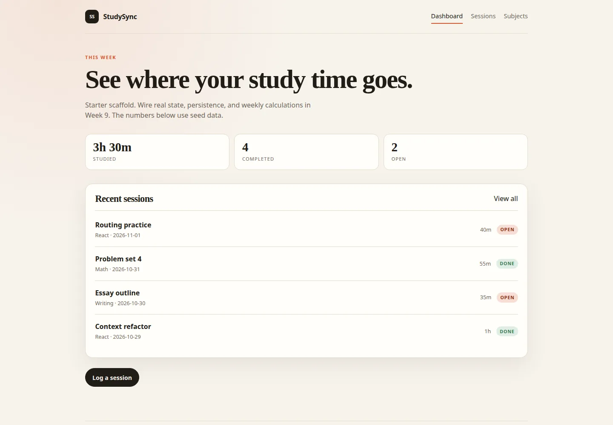

# Final project — StudySync

> **Build a study planner that helps a student see where their study time goes.**

StudySync is the capstone for React From Zero to Projects. You have ten weeks of
TaskFlow behind you. Now you build a larger app from a brief, with less hand-
holding.

**Timeline:** Weeks 9–10 · **Weight:** 40% of the course grade · **Team:** Solo

*The optional starter scaffold: routes and seed data, with the CRUD work left to
you.*

---

## The problem

Students study across several subjects, but their time is scattered. They cannot
easily answer:

- How much did I study this week?
- Which subject am I neglecting?
- What did I actually work on last Tuesday?

StudySync solves this with subjects, study sessions, and a dashboard that turns
sessions into useful progress.

---

## What you are building

A React single-page app where a student can:

1. **Manage subjects** — name, colour, weekly target.
2. **Log study sessions** — subject, title, date, duration, notes, completion.
3. **See the week** — total time, completed sessions, per-subject progress.
4. **Find sessions** — search, filter by subject/status, sort by date or duration.
5. **Review one session** — detail page with edit and delete.
6. **Use it anywhere** — responsive, keyboard accessible, persisted locally.

Then deploy it and present it.

---

## Required screens

| Route | Screen | Purpose |
| --- | --- | --- |
| `/` | Dashboard | Weekly stats, subject progress, recent sessions |
| `/sessions` | Sessions | Full list with search, filter, sort |
| `/sessions/new` | New session | Create a session |
| `/sessions/:sessionId` | Session detail | View, edit, delete |
| `/subjects` | Subjects | Manage subjects |
| `*` | Not found | Friendly 404 |

You may add routes (for example `/sessions/:id/edit`) but these must exist.

---

## Constraints

- React 19 + Vite.
- Function components and hooks; no class components except an error boundary.
- React Router for navigation.
- State with `useState`, `useReducer`, and Context. No Redux.
- Data persisted in `localStorage` (a mock API is optional).
- Tests with Vitest and React Testing Library.
- No backend required. No authentication. No payments.
- No secrets in the repository.
- You must be able to explain every line you submit.

---

## What you submit

1. A GitHub repository named `studysync-your-name`.
2. A deployed URL (Vercel or Netlify).
3. A README with setup, screenshots, and decisions.
4. A 5-minute demo video.
5. A `RETRO.md`.
6. Passing lint, tests, and build.

---

## Milestones

| Week | Milestone | Deliverable |
| --- | --- | --- |
| 9 | Plan + shell | Proposal, wireframes, routes, storage read, seed data, draft deploy |
| 10 | Complete + ship | CRUD, stats, tests, accessibility, deployment, README, demo |

**Week 9 gate:** the instructor must approve your proposal before you spend Week
10 building. A clear, small plan beats an ambitious, vague one.

---

## Scope guidance

### Build this first

1. Session create + list + persist.
2. Subject create + list.
3. Session toggle complete + delete.
4. Dashboard totals.
5. Edit flows.
6. Search and filter.

### Then add

7. Subject deletion guard.
8. Sorting.
9. Per-subject weekly progress.
10. Tests and accessibility.

### Stretch only if everything else is done

- Charts (use a small library or CSS bars).
- Dark mode.
- Import/export JSON.
- Mock API integration.
- Drag-and-drop reordering.
- Calendar view.
- PWA/offline support.

A complete app with six features beats an incomplete app with twelve.

---

## Definition of done

- [ ] All required routes work on refresh in production.
- [ ] Subjects and sessions can be created, edited, and deleted.
- [ ] Deleting a subject cannot silently orphan sessions.
- [ ] Dashboard stats are derived and correct.
- [ ] Search, filter, and sort work together.
- [ ] Validation errors are visible and announced.
- [ ] Empty states exist for no data and no matches.
- [ ] Keyboard-only use works.
- [ ] Responsive at 375 px.
- [ ] Data survives refresh.
- [ ] At least 8 meaningful tests pass.
- [ ] Deployed with a README and demo.
- [ ] No console errors.
- [ ] Lint, test, and build pass.

---

## Documents

- [Requirements](requirements.md) — the graded feature list
- [Proposal template](proposal.md) — fill this in during Week 9
- [Rubric](rubric.md) — how the 100 points are awarded
- [Presentation](presentation.md) — the 5-minute demo script
- [API contract](api-contract.md) — optional mock REST API
- [Mock API](mock-api/README.md) — run it locally
- [Starter](starter/README.md) — optional scaffold

---

## Academic honesty

You may reuse patterns and small utilities from TaskFlow. You may not submit a
copied tutorial project, a classmate's repository, or code you cannot explain.
The instructor may ask you to walk through any file.
