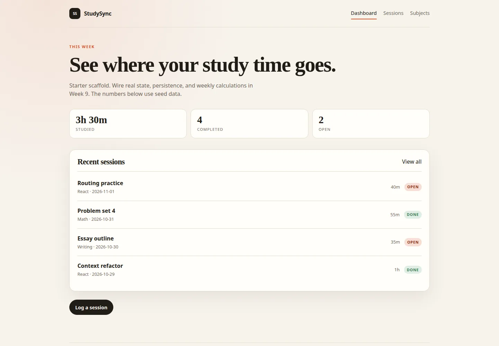

# StudySync starter (optional)

A route shell for the capstone: layout, navigation, seed data, and placeholder
pages. It deliberately does **not** include state, persistence, or CRUD.



## Use it

```bash
cp -r final-project/starter /path/to/studysync-your-name
cd /path/to/studysync-your-name
npm install
npm run dev
```

Then create a new GitHub repository and push:

```bash
git init
git add .
git commit -m "chore: scaffold StudySync"
git branch -M main
git remote add origin https://github.com/YOU/studysync-your-name.git
git push -u origin main
```

Do not commit `node_modules/` or `dist/`.

## What is included

- React 19 + Vite
- React Router with all required routes
- Layout with active navigation and a skip link
- Seed subjects and sessions (dates relative to today)
- Dashboard, sessions list, detail, form shell, subjects, and 404 pages
- Responsive CSS with focus styles and reduced-motion support

## What is missing (your work)

- `useLocalStorage` and safe read/write
- `subjectsReducer` and `sessionsReducer`
- Providers and memoized action helpers
- Controlled forms and validation
- Create, edit, delete, toggle
- Search, filters, sorting
- Weekly stats from real data
- Subject deletion policy
- Tests
- README, deployment, demo

Follow [`docs/week-09.md`](../../docs/week-09.md) and
[`docs/week-10.md`](../../docs/week-10.md).

## Adding tests

The starter omits test tooling to keep it small. Add it:

```bash
npm install -D vitest jsdom @testing-library/react @testing-library/jest-dom @testing-library/user-event
```

Update `vite.config.js`:

```js
import { defineConfig } from 'vitest/config'
import react from '@vitejs/plugin-react'

export default defineConfig({
  plugins: [react()],
  test: {
    environment: 'jsdom',
    globals: true,
    setupFiles: './src/test/setup.js',
  },
})
```

Create `src/test/setup.js`:

```js
import '@testing-library/jest-dom/vitest'
```

Add scripts:

```json
"test": "vitest run",
"test:watch": "vitest"
```

## Deploying

Add a rewrite so client-side routes work on refresh:

- **Vercel:** `vercel.json`
  ```json
  { "rewrites": [{ "source": "/(.*)", "destination": "/index.html" }] }
  ```
- **Netlify:** `public/_redirects`
  ```text
  /*    /index.html   200
  ```

Read [`requirements.md`](../requirements.md) before you start.
